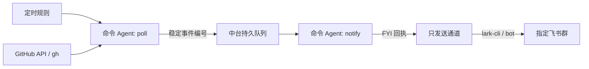

# 新 PR 发到飞书群

每分钟检查指定仓库；新建 PR 由已有应用机器人发一张群卡片，包含标题、作者、草稿状态和 GitHub 按钮。不调用模型，不读 PR 代码，不创建飞书事件监听。



首次成功读取每个仓库只建立基线，不补发历史 PR。此后包括草稿、轮询间已关闭的 PR；重新打开、推送、评论不发。暂时故障保留游标，下次接着查；来源确认已持久化才推进游标。中台仍用自己的队列、重派和卡片送达记录；飞书发送使用同一卡片编号的幂等键，不能承诺跨外部平台故障的绝对一次送达。

## 安装与配置

需要 Node 24+、已登录 github.com 的 `gh`、已配置机器人 profile 的 `lark-cli`。机器人须在目标群，有发送消息权限。读取仓库的权限由 gh 登录决定；群消息使用 bot 身份。

插件只依赖本目录与 Node 内置模块，可以复制到 `~/.agent-autoloop/plugins/github-pr-notify/`。不要只复制两个入口，要保留 `core.ts` 和 `main.ts`。也可以将这个目录的固定版本链接到该安装目录；更新后重启中台加载。无需修改内核。

把下面的虚构配置存为 `/绝对路径/pr-notify.json`，权限 0600，父目录 0700。CLI 参数都是本人维护的数组，不使用 shell；可以用绝对程序路径，或 `["node", "/路径/cli.js"]`。

```json
{
  "enabled": true,
  "repositories": ["example/pet-app", "example/pet-backend"],
  "stateDir": "/绝对路径/pr-notify-state",
  "hubUrl": "http://127.0.0.1:3350",
  "sourceName": "github-pr",
  "sourceKey": "来源密钥",
  "ghCommand": ["/绝对路径/gh"],
  "larkCommand": ["/绝对路径/lark-cli"],
  "profile": "existing-bot",
  "chatId": "oc_example"
}
```

只连接本机 HTTP 中台，禁止重定向。仓库清单显式维护；新增仓库第一次成功读取只建基线。不要删除游标文件来重试，这会把故障期间尚未通知的 PR 当作历史。

给来源、PR 通道、本机通道各建一把对应密钥，分别放进私有配置：

```sh
agent-autoloop key new source github-pr
agent-autoloop key new channel pr-group
agent-autoloop key new channel local
```

将这些条目**合并**到现有 `rules.json`，保留已有规则与来源：

```json
{
  "sources": { "github-pr": { "name": "GitHub 新 PR" } },
  "agents": {
    "pr-poll": {
      "name": "检查新 PR", "worker": "my-mac", "use": "github-pr-notify",
      "command": ["poll", "/绝对路径/pr-notify.json"], "timeout": 3, "maxActive": 1
    },
    "pr-notice": {
      "name": "整理 PR 卡片", "worker": "my-mac", "use": "github-pr-notify",
      "command": ["notify", "/绝对路径/pr-notify.json"], "maxActive": 1
    }
  },
  "channels": { "local": { "name": "本机记录" }, "pr-group": { "name": "PR 群通知" } },
  "defaultChannels": ["local"],
  "rules": [
    {
      "name": "检查新 PR", "when": { "cron": "* * * * *" }, "to": "pr-poll",
      "cwd": "/已有工作目录", "group": "pr-notify", "parallel": 1, "maxActive": 1, "tell": "never", "prompt": "检查新 PR"
    },
    {
      "name": "PR 群通知", "when": { "source": "github-pr", "types": ["pull_request.opened"] },
      "to": "pr-notice", "cwd": "/已有工作目录", "group": "pr-notify", "parallel": 1, "maxActive": 1, "prompt": "整理新 PR 通知",
      "channels": ["pr-group"]
    }
  ]
}
```

通知规则的 `parallel: 1` 让每个 PR 按 subject 独立排队，组内仍一次一轮；避免批量新增被合进超过回执上限的一轮。通知规则保留默认 `tell: needed`；`tell: never` 会抑制 FYI 卡片。

`defaultChannels` 不要指向 PR 群，避免将中台告警及其他规则的资料发进群。若已有合适的默认通道，保留它。没有默认通道时，复制官方 `examples/plugins/hello-channel/` 到安装目录的 `plugins/local-log/`，预建 0600 的本机日志文件。

`config.json` 对应合并：

```json
{
  "channels": {
    "local": { "use": "local-log", "key": "本机通道密钥", "file": "/绝对路径/private-cards.log" },
    "pr-group": { "use": "github-pr-notify", "key": "PR 通道密钥", "config": "/绝对路径/pr-notify.json" }
  }
}
```

运行 `agent-autoloop check`，空闲时 `agent-autoloop service install` 重启配置。建议 `worker.capacity` 至少 2，为长时间运行的 AI 与通知各留位置；原 AI 规则仍可设置 `maxActive: 1`。

## 查看、停用、卸载

```sh
agent-autoloop runs '检查新 PR'
agent-autoloop runs 'PR 群通知'
agent-autoloop why <轮次编号>
agent-autoloop pause '检查新 PR'
agent-autoloop resume '检查新 PR'
```

只暂停检查规则时，尚未投递的 PR 会在恢复后补发，因为来源游标未变。不要同时暂停通知规则后继续检查：中台对暂停规则不排队，恢复时需按提示 replay。要立即阻止发送，把私有配置 `enabled` 设为 false；已领取事件和卡片会报告失败，不会被当成已处理。恢复后中台在其重试预算内重派；超过预算的记录需人工从 `status`、`why` 核对并重新触发，不能保证长期停用后自动补发。长期停用宜先暂停检查规则、待通知队列清空再拔掉通道。移除两条规则、两个 Agent、来源及 PR 通道配置并重启，即可拔掉插件；本机默认通道及业务游标按需保留。

这台电脑休眠或离线时不会轮询；恢复后补读新增范围。每仓库通常每分钟一次 API 请求，仍受当前 GitHub 登录额度和权限限制。通知耗时是轮询间隔加上本机队列与外部 API 耗时，不保证一分钟内送达。

## 验证

`node --test tests/github-pr-notify.test.ts` 使用临时目录、临时中台、假 GitHub/飞书 CLI，覆盖游标、分页、丢失回执、标准安装、FYI 和群路由。测试不连接现有业务监听或发送真实群消息。真实安装的版本和读回证据另记在部署记录中。
